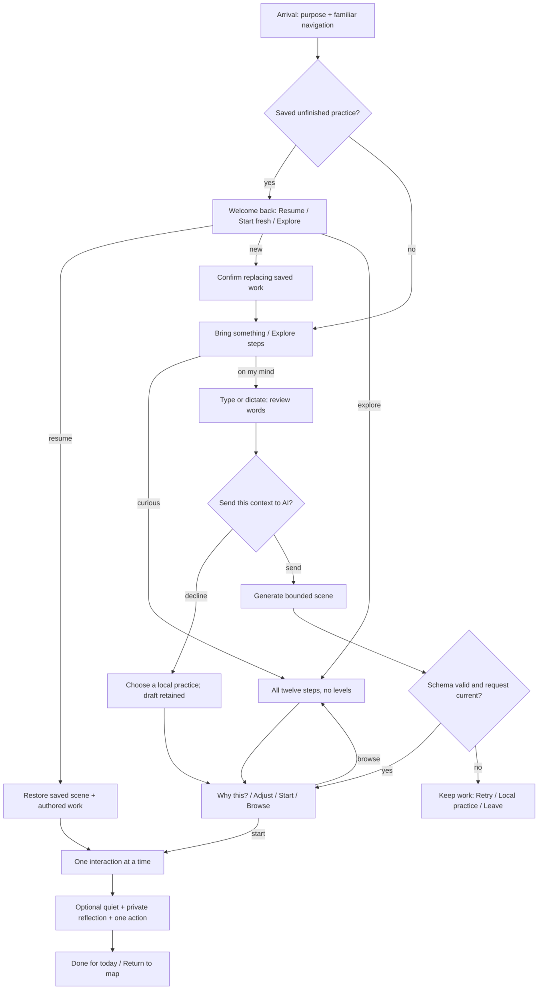
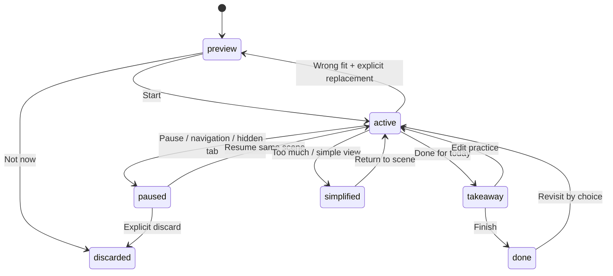
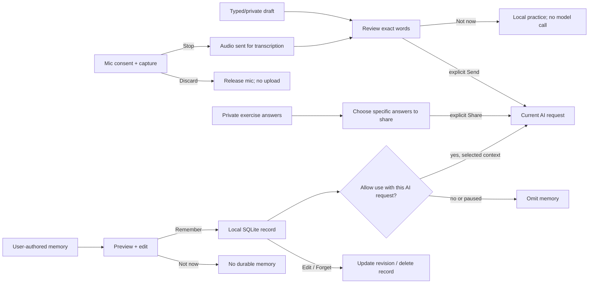

# soulfire journey design — review checkpoint

October 24, 2026. **Journey design proposal with a completed thin architecture slice.** The existing local prototype and completed dictation work remain intact. Current application: http://127.0.0.1:3100. Open `index.html` for rendered diagrams and the state explorer.

## Product promise

**“Soulfire is your spiritual guide: a different way to work through life’s challenges through reflection and spiritual principles.”** Follow with two ordinary choices: **Bring what’s on your mind** and **Explore the steps**. Keep Play introduction secondary and immediately skippable. The narration can evolve to match this promise after the flow review; this artifact does not change the current Kokoro recording.

A short boundary belongs in About and relevant support moments: “Spiritual self-help, not a replacement for professional care.” No claimed treatment effect, authority over beliefs, diagnosis or hidden personality profile. An unusual landscape can feel distinctive without making Back, Pause, sound, memory or Finish unusual.

## Stable frame, adaptive interior

Home · Practices · My memory remain stable. Within a practice: Back · Pause · Done for today. Motion/sound controls keep their familiar location. The model chooses trusted scene components, short prompts and situation-specific options; it never generates executable HTML, JavaScript, arbitrary CSS or navigation.

There is no twelve-step completion ladder. “Guided” means help choosing and moving through one practice, not obligation to advance to the next numbered step. The map is available before sharing anything. A quiet visit or an unfinished exercise can still end normally.

## Seven journeys

| Journey | Experience | Important exception | Current status |
|---|---|---|---|
| Curious first visit | Purpose → optional intro → Explore → scene preview → start or leave | No text disclosure, AI call or memory opt-in needed to explore | Map exists; only four steps interactive; expanded arrival/map proposed |
| Something on my mind | Type or dictate → review → explicit Send → suggested scene → Why this / adjust / browse | Declining AI keeps draft and opens a local path; never auto-submit transcript | Input/AI suggestion/editable dictation exist; explicit context review and Why this proposed |
| Guided practice | Preview → optional sensory choices → one visual interaction → optional quiet/reflection → chosen action | Skip any prompt; “done” is session completion, not mastery | Flow exists; one reusable visual influence map implemented; other scene families proposed |
| Unfinished return | Neutral welcome → Resume / New / Explore | Restore exact saved version and interaction state; never silently regenerate | Browser saved practice + explicit replacement confirmation exist; version-1 scene restoration implemented |
| Return after absence | Welcome back → continue or explore → optional private memory review | No guilt, missed-day counters or personal text exposed on landing | Neutral welcome exists; relevance review proposed |
| Memory | My memory → write/preview → Remember / Edit / Not now → inspect/pause/delete | Saving and use with AI are independent; no silent transcript or reflection extraction | User-authored local SQLite notes, edit/delete/pause and per-request AI selection implemented; automatic suggested memories deferred |
| Interruption or mismatch | Pause → what stopped and what saved → Resume / simpler local scene / Retry / Discard | Invalid/late model output cannot replace work; real voice stays off until explicit restart | Capture/response cancellation and pause exist; unified recovery state proposed |

## Practice lifecycle

Keep authored work separate from its generated scene. A new generation is a proposal until accepted. “That’s not right” offers edit the premise, choose another principle, or browse; it does not infer a personality trait. “Too much” stops optional motion/audio and offers simple view or leaving. Repair-related scenes must include boundaries, postponement and no contact as valid choices. No action contacts another person.

## Data, consent and memory

Three independent controls: **process now**, **save this practice**, **remember for future requests**. Microphone permission is a fourth boundary: cloud dictation sends recorded audio before transcript submission, so its disclosure precedes recording. Live voice is separately opted into. No memory import from the existing browser practice store. No inferred preferences in the first persistence iteration; a future proposed inference must be previewed and confirmed before it becomes memory.

Suggested memory record: category (goal / current challenge / preference), short user-authored text, provenance=`user_confirmed`, created/edited timestamp, revision and allowed-use flag. Keep at most a handful of short notes. Return home exposes no note text. My memory exposes every saved note, what is used and how to edit/forget it. Pause use retains the record without sending it. Delete must remove durable content and invalidate stale writes; retries cannot resurrect it. Remembering a note is not training the model.

SQLite repository methods should be asynchronous at the interface (`read`, `replace(expectedRevision)`, `delete(expectedRevision)`) so a later Postgres adapter does not change the app contract. One local browser profile, no account service. Store outside the checkout with restrictive filesystem permissions. Plaintext at rest; do not call it encrypted. No journal/history archive in this iteration. Keep `.env.local` and database files out of Git, test fixtures and source backups. Existing browser practice saving stays separate and unchanged.

## State contract and precedence

| Dimension | States | Invariant |
|---|---|---|
| Introduction | never / started / completed / skipped | Replay requires actual playback, not skip. Intro never gates entry. |
| Intent | explore / reflect / resume | Exploration never requires disclosure or AI. |
| AI consent | not asked / accepted for request / declined | Exact reviewed context only; declining preserves local use. |
| Memory | off / on / paused / deleting / unavailable | On does not automatically mean share; pending delete blocks stale saves and use. |
| Exercise | preview / active / paused / takeaway / done / discarded | Resume restores scene version and authored state; replacement is explicit. |
| Generation | idle / pending / ready / invalid / failed / canceled | Sequence IDs reject late results; validation failure leaves current scene intact. |
| Input | typing / permission pending / recording / transcribing / review / canceled | Waveform only during capture; Stop releases mic before async processing. |
| Sensory | motion permitted/paused/reduced; music enabled/muted/blocked; narration playing/stopped | OS reduced motion wins; speech ducks/pauses music; no success claim after blocked autoplay. |
| Feedback | fits / wrong / too intense / outdated | Feedback changes a local choice, not a psychological score. |

Precedence: explicit Stop/Discard and safety interruption first; pending deletion disables personalization; cancellation invalidates in-flight responses; OS reduced motion overrides animation preference; failed persistence never displays Saved. A completed exercise does not silently create memory or enable saving.

## Scene families: hypotheses to prototype

| Steps | Interaction, not decoration | Familiar / nonanimated equivalent |
|---|---|---|
| 1–3 | Place editable thought-stones among influence/release constellations; select a support point; release only what the person chooses | Labeled groups, buttons and move selectors; static arrangement |
| 4–5 | Build a small event → interpretation → choice map; choose what stays private and what could be discussed with a trusted person | Ordered editable list; no compelled disclosure, no real contact |
| 6–7 | Try one fork in a short path; bring a support lantern beside the next step | Choice buttons and editable action; never a willingness score |
| 8–9 | Put a boundary gate before any possible repair; choose no contact, later, or a safe draft | Explicit choices and draft; nothing sent and no pressure to forgive |
| 10–11 | Check-in compass or optional stillness pool; choose an outward sensory anchor or simple quiet | Static choices and timer; no forced breathing/holds |
| 12 | Plant one small service intention; revisit/edit/remove without streaks or wilted failure metaphors | Editable intention list and Done for today |

Visual feedback should follow meaningful user action. Quiet scenery pauses while reading/editing when it competes with comprehension. Keep ambient music as an optional existing preference, not evidence of benefit. New narration or interaction sounds require explicit play. No sound is needed to understand a choice.

## Research basis and limits

- [Microsoft HAX guidelines](https://www.microsoft.com/en-us/haxtoolkit/ai-guidelines/): design initial use, correction, failure and change over time. Applied here as stable controls and visible recovery; not an evaluation of soulfire.
- [CHI 2024 design principles](https://arxiv.org/abs/2401.14484): principles derived from literature, practitioner input and application design. Useful process guidance, not clinical evidence.
- [PAIR mental models](https://pair.withgoogle.com/guidebook-v2/chapter/mental-models/), [feedback/control](https://pair.withgoogle.com/guidebook-v2/chapter/feedback-controls/), [graceful failure](https://pair.withgoogle.com/guidebook-v2/chapter/errors-failing/): explain adaptation in stages, permit correction and offer paths after failure. Applied as Why this, explicit remembered context and local fallback.
- [WCAG 2.2](https://www.w3.org/TR/WCAG22/): keyboard access, readable labels, visible focus, adequate targets and control over motion/audio inform acceptance checks. No claim of full conformance without audit.
- [Affect-labeling laboratory study](https://pubmed.ncbi.nlm.nih.gov/17576282/) and [nature-sound laboratory study](https://pmc.ncbi.nlm.nih.gov/articles/PMC2872309/) motivate optional exploration, not claims that a visual/audio app treats distress or changes the brain beneficially.
- Parent-supplied optional breathing evidence DOI `10.1016/j.xcrm.2022.100895` could not be fetched here (403). It is not used to justify a prescribed breathing rhythm. The proposed scenes avoid breath holds.

Evaluate comprehension, sense of agency, perceived relevance, successful resume and memory understanding—not time spent, adherence to a step order, symptom reduction or inferred personality accuracy. Observe whether people can leave, mute, correct a premise, recover without losing work and delete memory.

## Implementation sequence and review decisions

1. Review this state architecture and independent critiques before expanding onboarding. Preserve the current application during review.
2. Build a versioned declarative scene adapter and all-step local examples; retain old saved-exercise compatibility.
3. Implement minimal opt-in memory repository and its isolated restart/concurrency/delete tests. Connect memory to AI only with visible consent.
4. Add Why this / adjust / simple view / failure fallback to the same stable shell.
5. Validate desktop/mobile, keyboard, reduced motion, canceled/repeated requests, scene restoration and persistence deletion. Keep provider tests synthetic unless a separate live request is authorized.

Deferred: personality inference, automatic journaling, multi-device accounts, hosted Postgres, therapeutic efficacy claims, external sharing/contact, sophisticated individual audio generation. These are outside the coherent local slice.

## Implementation checkpoint

The companion provider/repository boundaries, versioned visual influence map and explicit local memory are implemented. See [architecture](../../implementation/architecture.md) and [validation](../../implementation/architecture-validation.md). Broader diagrams remain target journeys; their mixed/proposed labels are intentional. No multi-harness synthesis is claimed while BB context isolation is blocked.
