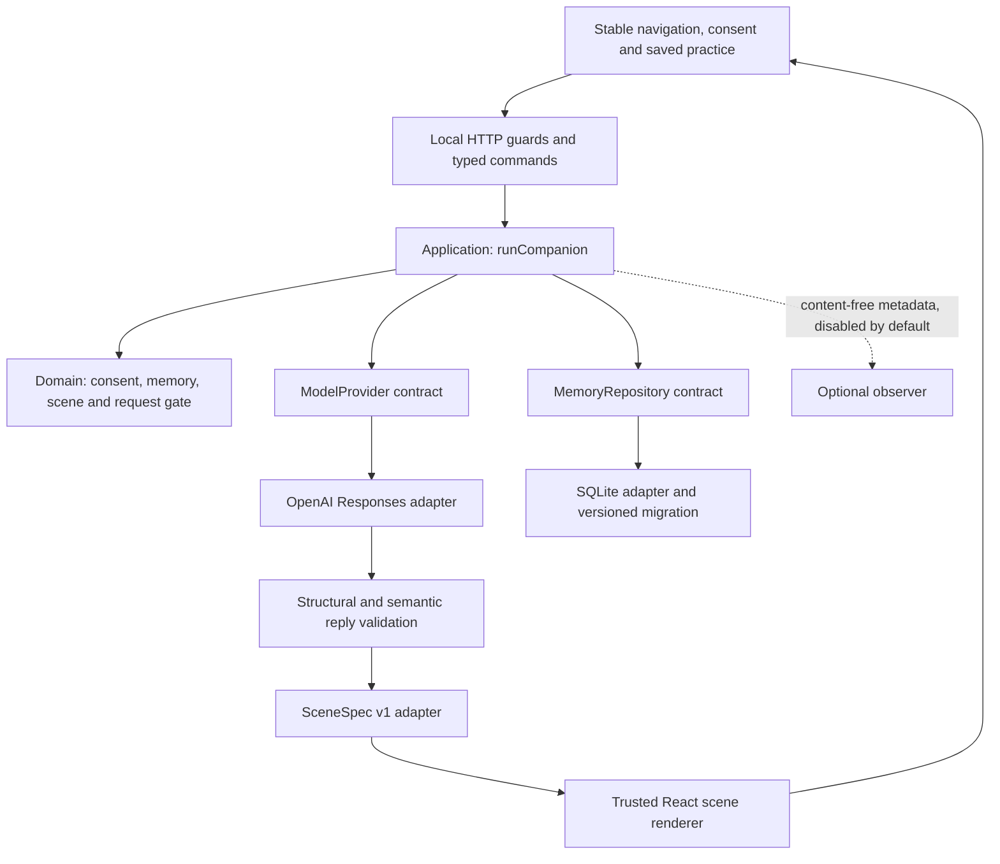

# soulfire architecture — validated thin slice

October 24, 2026. Local-only modular monolith. Source: `/Users/miguelalvarado/Coding/soulfire`. No new deployment or push. This is an incremental boundary extraction around the working prototype, not a complete client rewrite or an autonomous multi-agent system.

## Implemented boundaries

| Boundary | Files | Responsibility |
|---|---|---|
| Domain | `src/domain/{memory,scene,session}.ts` | Provider-independent values, consent predicate, memory repository contract, scene version and stale-request gate |
| Application | `src/application/companion.ts` | Safety interruption, minimal authorized context, provider call, semantic validation, provenance and redacted outcome event |
| Provider | `src/infrastructure/openai-responses.ts` | Direct Responses transport, strict output schema, explicit refused/incomplete/invalid outcomes |
| Persistence | `src/infrastructure/sqlite-memory.ts` | Private local path, migration version, transactional revision checks and deletion tombstone |
| HTTP | `app/api/{companion,memory}/route.ts` | Local-origin boundary, bounded input, explicit memory consent, safe errors and no-store responses |
| Presentation | `SceneRenderer.tsx`, `MemoryPanel.tsx`, existing `Soulfire.tsx` | Trusted interaction, explicit choices and preserved navigation. The existing large client component is not yet fully extracted. |

One bounded generation call is sufficient here. There are no model-executable tools or handoffs. The model cannot authorize storage/deletion, change consent, invoke navigation or execute generated JavaScript/HTML. A future tool must have a typed input/output contract, deterministic authorization, cancellation and an explicit bounded effect before it is exposed. Direct calls are simpler than adding a framework to this current flow; this is an engineering choice informed by [OpenAI’s practical guide](https://openai.com/business/guides-and-resources/a-practical-guide-to-building-ai-agents/), not an OpenAI-mandated architecture.

## Thin visual slice

The existing generated exercise contract is adapted to a version-1 influence map: two to four named zones and up to eight thought stones. A user selects a thought and places it with a labeled button; the position moves gently. Keyboard controls, text editing and reduced-motion alternatives remain available. Unsupported scene shapes retain the simple controls. Other trusted exercise types continue working. The model supplies short content and options, never layout code, assets, HTML or CSS.

The stored browser practice records `sceneVersion: 1`, the validated exercise and authored answers. Resume restores that content rather than regenerating. Legacy snapshots without the optional version still load. New model output rejects reserved IDs, duplicate options and incompatible control shapes without silently invalidating older saved user work. Strict structured output alone does not establish semantic correctness; refusal and incomplete output are separate outcomes. See [Structured Outputs](https://developers.openai.com/api/docs/guides/structured-outputs).

The original four interactive steps remain available. The full twelve-step scene families, unified recovery frame, new arrival choices and expanded map in the journey diagrams are proposals. This slice does not claim to implement all of them.

## Consent and memory

There is one local Mac profile, not an authenticated account. My memory contains three short user-authored notes: goal, challenge and explicit preferences. Saving requires a deliberate action. No existing journal, reflection, dictation or saved practice is imported. The UI explains that anyone using this local app can open its memory.

Remembering notes and allowing their AI use are separate. Each generation additionally requires a fresh unchecked-by-default “Include my saved memory with this request” choice. The application reads the server store only when selected and sends only those three note fields. The adapter labels them tentative user-provided data, never instructions or inferred personality. Reflection sharing sends only its selected current user message and no saved memory. Dictation and live voice have no new memory integration.

Editing, pausing AI use and deletion are visible. Failed saves/deletes remain visible and can be reloaded. An expected revision protects updates; a content-free revision tombstone prevents a delayed pre-deletion save from resurrecting notes. Canceling a network request does not promise to undo a save already committed: reload is the source of truth. Deletion cannot recall context already sent to a provider.

Default storage: `~/Library/Application Support/soulfire/memory.sqlite`, outside the repository. No file is created by an empty read. New directories use mode 0700 and the database mode 0600. This is plaintext storage protected by OS access, not encryption or per-user authentication. `secure_delete` removes deleted payload bytes in the tested live database; it is not a forensic guarantee for filesystem snapshots/backups. No raw audio is retained by this feature.

`SOULFIRE_DATA_DIR` supports isolated tests; storage inside the project, including resolved symlinks, is rejected. Database files are ignored by Git as defense in depth. Local HTTP origin checks are not a substitute for authentication if this ever becomes a shared service.

## Durability and migration

The database uses schema version `PRAGMA user_version=1`, a single profile row, JSON payload validated against version-1 domain schemas and integer revision. Initialization and mutations use transactions; mutations use `BEGIN IMMEDIATE`, bounded busy timeout and conditional revision validation. Unknown future versions fail closed. Tests cover fresh-process reads, concurrent stale edits, unsupported versions and deletion.

A Postgres adapter can implement the same asynchronous `MemoryRepository` contract, but migration requires real work:

1. Add authenticated ownership and tenant/profile IDs to commands and repository operations before hosting.
2. Introduce ordered transactional migrations with deployment rollback/forward policy and explicit data-version handling.
3. Map JSON to JSONB while retaining application validation; decide UTC timestamp and integer limits explicitly.
4. Implement optimistic updates/deletes with `WHERE revision = expected`, verify affected rows, and test conflicts under real Postgres concurrency/isolation.
5. Run the shared repository contract suite against both databases, including restart, deletion and failure behavior. Add Postgres-specific transaction and connection-pool tests.
6. Only with user consent, export/validate/import real memory, preserve IDs/revisions, verify counts and deletion semantics, and define retention of old copies/backups. Never silently move private data.

SQLite remains adequate for this single local profile. Node 22.15.0’s built-in SQLite API emits an experimental warning; pin the runtime for this prototype and reassess the adapter before a pilot. Observed dependency versions: Next 15.5.27, React 19.3.0, Zod 4.6.5, TypeScript 5.9.3. No OpenAI SDK dependency was added. Existing lockfile resolves the package ranges; deployment reproducibility also requires a pinned Node runtime.

## Cancellation, cost and failure

The provider transport combines request cancellation with a 45-second deadline and a 2,200-output-token limit. There are zero automatic provider retries. A retry is a fresh intentional user action. The client request gate rejects late results after interruption/replacement; the application rechecks cancellation before and after provider work. This cannot guarantee cancellation of provider billing after a request has already reached it.

Invalid output, refusal, timeout and unavailable memory do not replace current work. If selected memory cannot be read, generation fails rather than quietly changing personalization; the user can retry or choose a local example. Local examples are labeled, and mock tests never masquerade as real model success.

The optional event observer receives only operation, outcome, duration and a used-memory boolean; it is a no-op by default. It receives no text, audio, key or payload. No Agents SDK tracing or hosted eval integration is installed. `store:false` is set on Responses, but it does **not** promise zero provider retention; see [OpenAI data controls](https://developers.openai.com/api/docs/guides/your-data).

## Evaluation and pilot gate

Repository-owned synthetic tests exercise schemas, consent, selected context, cancellation, stale responses, CRUD and rendering. They are regression checks, not proof of model usefulness, neuroscience effects or therapeutic benefit. No new paid model call or personal ambient recording was made for this slice. Existing real OpenAI setup is retained; its earlier acceptance is documented separately.

Keep fixtures and runners portable. [OpenAI’s evaluation guidance](https://developers.openai.com/api/docs/guides/evaluation-best-practices) currently states hosted Evals becomes read-only October 31, 2026 and is scheduled to shut down November 30, 2026; this implementation has no dependency on it.

Before any shared pilot: add identity/isolation, review deletion/retention and incident recovery, verify provider context with synthetic end-to-end cases, establish budget controls, and conduct human task tests of comprehension, agency, relevance and resume. Measure whether people understand what is remembered and can correct or delete it; do not optimize for time spent or claim clinical efficacy. No pilot access or public deployment is enabled here.

## Review artifacts

- `docs/design/journeys/index.html`: rendered journey diagrams and state explorer.
- `docs/design/journeys/journeys.md`: proposed journeys, state matrix and research limits.
- `docs/design/journeys/harness-comparison.md`: exact BB model discovery and blocked comparison status.
- `docs/implementation/architecture-validation.md`: final checks and limitations.
